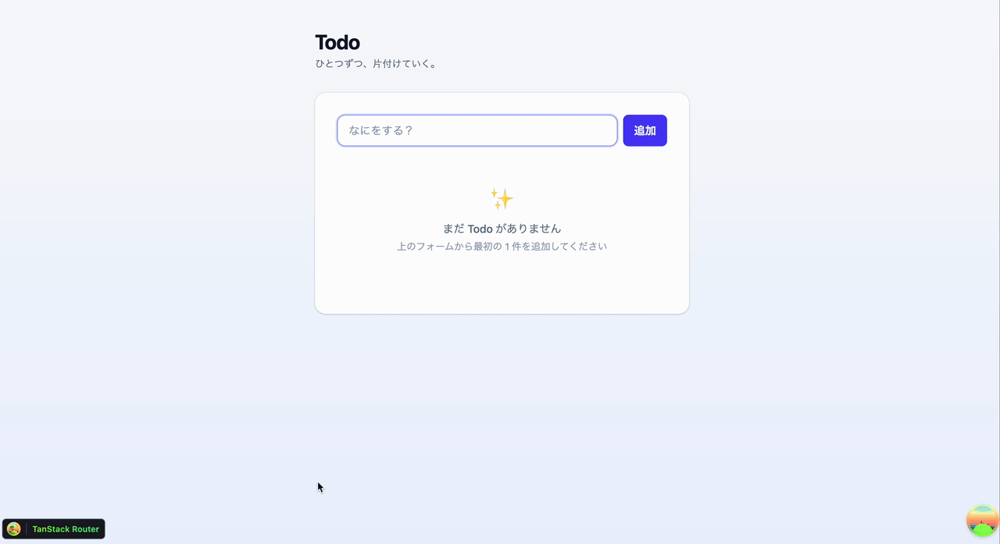
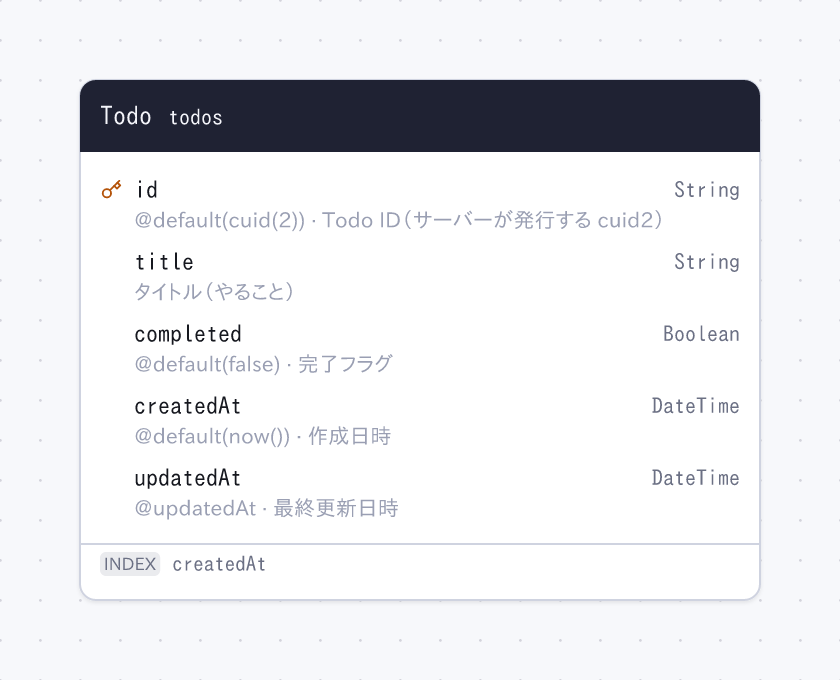

# zod-openapi-hono-todo

TypeSpec と Prisma を正典に、API とデータベース定義を生成する Todo アプリ。
Cloudflare Workers + D1 + React SPA。



[ドキュメント](https://nakita628.github.io/zod-openapi-hono-todo/index.html)（TypeDoc / `pnpm typedoc`）

## Getting started

```sh
pnpm install
pnpm generate       # src/db/schema.ts からマイグレーションを生成
pnpm local:migrate  # ローカル D1 に適用
pnpm dev            # http://localhost:8787
```

Cloudflare の設定は `cloudflare.config.ts`、操作は [cf](https://www.npmjs.com/package/cf) CLI で行う。
マイグレーションの適用も cf が行う（`drizzle-kit` は SQL の生成だけ）。
リモートへは、`cf d1 create` などで作った D1 の ID を `cloudflare.config.ts` と
`package.json` の `*:migrate` に入れ、`cf auth login` 済みの状態で `pnpm remote:migrate` / `pnpm deploy` を実行する。


